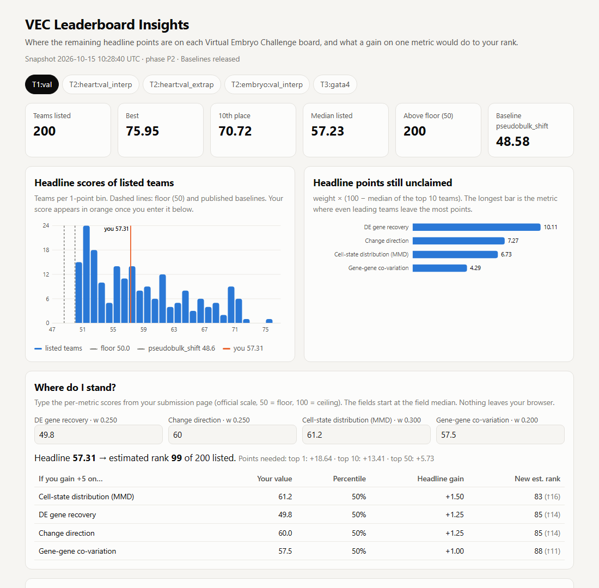

# VEC Leaderboard Insights

**Which metric should I improve next, and what is it worth in rank?**

This is a small, dependency-free tool for participants of the
[Virtual Embryo Challenge](https://virtualembryo.ai/challenge) (NeurIPS 2026). It reads the
**public leaderboard** and answers three questions the leaderboard page does not:

1. **Where are the headline points still unclaimed?** For each board and metric: the field
   median, the top-10 median, the best score, the share of teams below the floor, and how many
   headline points even the leading teams still leave on the table.
2. **Where do I stand?** Enter the per-metric scores from your submission page to get your
   estimated rank, your percentile on each metric, and the rank you would reach by gaining
   *N* points on any single metric.
3. **How is the field moving?** A GitHub Action stores one anonymised snapshot a day and
   plots the best, 10th-place and median headline over time.

**Live dashboard:** https://waelytz.github.io/vec-leaderboard-insights/ (no install; the calculator runs in your browser and sends nothing anywhere)



It needs **no Challenge data and no account**. It only uses the numbers the public leaderboard
already shows, so it complements the data-side tools (veckit, validators, local scorers) and
does not duplicate them.

## What it found on 15 October 2026 (P2, validation boards)

From the snapshot in [`snapshots/`](snapshots/). Run `vec-insights headroom` for the full tables.

| Board | Best | 10th | Median listed | Biggest unclaimed metric |
|---|---:|---:|---:|---|
| T1:val | 76.0 | 70.7 | 57.2 | `de_score`, 10.1 headline points |
| T2:heart:val_interp | 74.4 | 70.2 | 64.2 | `neighborhood_mmd`, 6.8 |
| T2:heart:val_extrap | 67.7 | 62.7 | 54.6 | `neighborhood_mmd`, 9.6 |
| T2:embryo:val_interp | 77.7 | 75.8 | 65.5 | `neighborhood_mmd`, 6.4 |
| T3:gata4 | 80.5 | 76.1 | 62.7 | `de_score`, 9.3 |

Observations a participant can act on:

- **The published baselines are below the floor** on T1 (`pseudobulk_shift` 48.6),
  T2 heart extrapolation (47.8) and T3 (`shift_transfer` 42.5, `gene_ko` 42.5). Resubmitting the
  previous stage (50) is the real bar to beat.
- **T1: differential-expression recovery is the bottleneck.** 52% of listed teams score *below
  the floor* on `de_score`, and the top-10 median is only 59.6. Distribution metrics
  (`mmd_u`, `variogram`) separate teams more today, but `de_score` has the most points left.
- **T3: two different situations.** `severity_slope` (response magnitude) is nearly solved by
  the leaders (top-10 median 98.7) but has the widest spread in the field (12.3 weighted points).
  If you are mid-table, fixing magnitude is the cheapest big gain. If you are near the top,
  `de_score` (30% weight, top-10 median 69.0) is where the points are.
- **T2: local spatial organisation (`neighborhood_mmd`, 25% weight) is the largest unclaimed
  block on every board**, while growth scale is saturated (51% of teams at 100 on heart extrapolation).

These numbers are from one snapshot. The board moves daily, and the hidden test set can rank
teams differently from validation.

## Install and use

Python 3.9+, no third-party dependencies.

```bash
pip install git+https://github.com/WaelYTz/vec-leaderboard-insights
# or: git clone ... && cd vec-leaderboard-insights && pip install .

vec-insights snapshot                 # fetch the public board -> snapshots/snapshot_<time>Z.json
vec-insights overview                 # one line per board
vec-insights headroom --board T1:val  # per-metric table (omit --board for all boards)
vec-insights whereami --board T3:gata4 \
    --metrics de_score=62 de_direction=66 severity_slope=95 mmd_u=70 variogram=72
vec-insights dashboard                # write docs/index.html (self-contained, works offline)
```

Add `--live` to `overview`, `headroom` or `whereami` to read the board directly instead of the
latest snapshot. `python -m vec_insights ...` works too.

Example `whereami` output (snapshot of 15 October):

```text
Headline 73.01 -> estimated rank 27 of 200 listed teams
Points needed: top 1 +7.50, top 10 +3.12

| Metric                          | Weight | Yours | Percentile | Headline gain (+5) | New est. rank |
| DE gene recovery (de_score)     | 0.300  | 62.0  | 80%        | +1.50              | 20            |
| Change direction (de_direction) | 0.250  | 66.0  | 88%        | +1.25              | 21            |
| Response magnitude              | 0.250  | 95.0  | 69%        | +1.25              | 21            |
| ...
```

Metric names per task:

| Task | Metrics (weight) |
|---|---|
| T1 | `de_score` .25, `de_direction` .25, `mmd_u` .30, `variogram` .20 |
| T2 | `de_score` .125, `de_direction` .125, `mmd_u` .15, `variogram` .10, `d2_shape` 1/12, `occupancy_dice` 1/12, `scale_log_ratio` 1/12, `neighborhood_mmd` .25 |
| T3 | `de_score` .30, `de_direction` .25, `severity_slope` .25, `mmd_u` .12, `variogram` .08 |

## How it works

- **Headline formula.** The weights come from the group weights on the
  [task pages](https://virtualembryo.ai/challenge/tasks). On the 15 October snapshot they reproduce
  **every** published headline to 0.0001 on T1:val, T2:embryo:val_interp and T3:gata4 (600/600 rows).
  On the two T2 heart boards, 181/200 and 199/200 rows match. The rest sit up to ~1 point below the
  formula, which points to a component the public API does not show (the FAQ mentions a
  `count_log_ratio`). Every `headroom` report prints this check, so you can see it on any snapshot.
  `whereami` accepts `--headline` if you want to use the exact value the site gave you.
- **Missing metrics count as 50**, following the FAQ ("counts as zero skill").
- **Estimated rank** = 1 + the number of listed teams with a strictly higher headline.
- **Unclaimed** = weight × (100 − top-10 median). **Spread** = weight × (p90 − p10) over listed teams.
- **Scope.** The public board lists up to 200 teams per board, so percentiles and ranks are
  relative to those teams.

## Privacy and data use

- Only public, unauthenticated endpoints are read: the ones the leaderboard page itself uses.
  A snapshot is ~7 small requests, and the Action runs once a day.
- **Team names, affiliations and model strings are dropped before anything is written.** A snapshot
  row keeps only `rank, track, headline, metrics, scored_at`. A test (`test_fetch_snapshot_anonymises`)
  enforces this.
- No Challenge dataset files are read, stored or redistributed.

## Limitations

- It explains the *validation* leaderboard. It cannot predict hidden-test performance, and it is
  not a scorer. Use [veckit](https://github.com/aristoteleo/veckit) to score `.h5ad` files locally.
- Ranks are estimates against one snapshot. Other teams keep submitting.
- If the organisers change the metric panel or weights, `formula_check` will show mismatches, and
  `weights.py` needs updating.
- When the test phase (P3) opens, new board keys appear in the API. Snapshots pick them up
  automatically, but the per-task weights are assumed unchanged.

## Development

```bash
python -m venv .venv && . .venv/bin/activate   # Windows: .venv\Scripts\activate
pip install -e ".[test]"
pytest -q        # 22 offline tests with synthetic fixtures; no network needed
```

The daily workflow is in [`.github/workflows/snapshot.yml`](.github/workflows/snapshot.yml).
GitHub Pages serves `docs/` from the `main` branch.

## En bref (français)

**VEC Leaderboard Insights** lit le classement public du Virtual Embryo Challenge et indique, pour
chaque tableau, **sur quelle métrique il reste le plus de points à gagner**. Saisissez vos scores par
métrique (page de votre soumission) dans le tableau de bord pour obtenir votre **rang estimé** et le
gain de rang si vous amélioriez une seule métrique de *N* points. Aucune donnée du challenge ni compte
n'est nécessaire. Les noms d'équipes et affiliations sont supprimés avant tout enregistrement.
Installation : `pip install git+https://github.com/WaelYTz/vec-leaderboard-insights`, puis
`vec-insights overview`.

## Acknowledgements

Built for the Virtual Embryo Challenge community. The challenge, its metrics and the leaderboard
belong to the organisers (Qiu Lab, Stanford University, and collaborators). The data are credited
to Dr. Neil Chi's group at UC San Diego. This project is unofficial and not endorsed by the
organisers. Development was AI-assisted (Claude Code). The analysis and every number above were
produced by running the code in this repository.

MIT licence.
